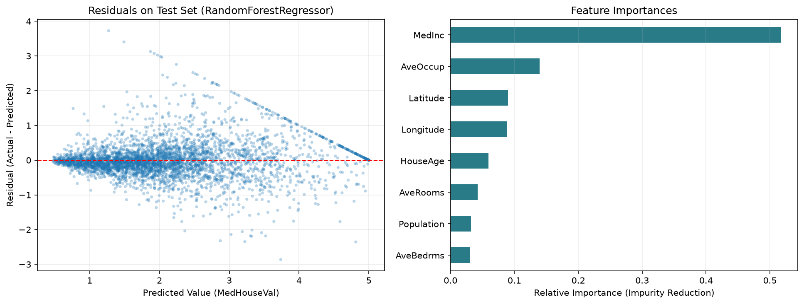

# Relatório – Trabalho 3 (GCC1734 – Inteligência Artificial)

- **Disciplina:** GCC1734 – Inteligência Artificial (CEFET/RJ)
- **Matrícula:** 2221875BCC
- **Dataset atribuído:** California Housing (ID = 4, Regressão)

---

## Q1 – Dados, Preparação e Protocolo Experimental

### Arquivos relevantes
- `ml/data_pipeline.py` — carregamento, divisão aleatória, pipeline de pré-processamento e resumo estatístico.
- `requirements.txt` — dependências e versões fixadas para reprodutibilidade.


### 1.1 Descrição das entradas, alvo, tarefa e riscos de interpretação
Pela regra da matrícula (`2221875BCC`), $\text{ID}(2221875) = [(2221875 \bmod 4) + 1] = 4$, atribuindo o conjunto **California Housing**. Ele é carregado com `fetch_california_housing(as_frame=True)` na função `load_dataset()`, preservando os dados como DataFrame e Series do *pandas*.

- **Tipo de tarefa:** **Regressão supervisionada**, cujo objetivo é estimar uma variável numérica contínua ($y \in \mathbb{R}$) a partir de 8 atributos numéricos contínuos.
- **Variável-alvo (target):** `MedHouseVal` — valor mediano das residências no grupo de blocos censitários, expresso em centenas de milhares de dólares.
- **Variáveis de entrada (features):**

| Atributo | Descrição |
| :--- | :--- |
| `MedInc` | Renda mediana no grupo de blocos (em dezenas de milhares de US$). |
| `HouseAge` | Idade mediana das residências no grupo de blocos (em anos). |
| `AveRooms` | Número médio de cômodos por domicílio. |
| `AveBedrms` | Número médio de quartos por domicílio. |
| `Population` | População total residente no grupo de blocos. |
| `AveOccup` | Número médio de moradores por domicílio. |
| `Latitude` | Latitude geográfica do grupo de blocos. |
| `Longitude` | Longitude geográfica do grupo de blocos. |

**Riscos de interpretação e limites do domínio:**

1. **Granularidade agregada:** cada registro representa um *block group* censitário, e não um imóvel individual. Não é válido interpretar a previsão como avaliação direta de uma casa específica.
2. **Defasagem temporal:** os dados provêm do Censo dos EUA de 1990, portanto os valores monetários não refletem o mercado imobiliário atual.

### 1.2 Divisão em treino, validação e teste
A divisão é realizada na função `split_dataset()` (`ml/data_pipeline.py`) imediatamente após o carregamento dos dados brutos e **antes** de qualquer transformação ou cálculo estatístico.

- **Proporções adotadas:** **60% treino / 20% validação / 20% teste**.
  - Como `train_test_split` realiza uma partição binária por chamada, a divisão foi feita em duas etapas:
    1. Separação de 20% para teste (`test_size=0.2`), restando 80% para desenvolvimento;
    2. Separação de `val_relative = 0.2 / (1.0 - 0.2) = 0.25` sobre os 80% restantes, resultando em 60% do total para treino e 20% para validação.
  - **Justificativa das proporções:** com 20.640 instâncias, a divisão `60/20/20` mantém 12.384 exemplos para ajuste dos modelos e 4.128 exemplos independentes tanto na validação (para comparação de modelos e hiperparâmetros na Q2) quanto no teste final, oferecendo estabilidade estatística nas métricas de erro sem comprometer o aprendizado.
- **Semente e embaralhamento:** utilizou-se `shuffle=True` (essencial para desfazer ordenação geográfica original dos blocos censitários) e `random_state = SEED = 2221875` (parte numérica da matrícula) em ambas as chamadas, assegurando reprodutibilidade determinística.
- **Verificação de integridade da divisão:** a função valida que os tamanhos são positivos e somam menos que 1.0, e executa `assert` confirmando que os conjuntos de índices de treino, validação e teste são **mutuamente disjuntos** (`isdisjoint`) e que sua soma equivale exatamente ao total original (20.640).

---

### 1.3 Pipeline de pré-processamento
Na função `build_preprocessor()`, foi construído um `Pipeline` do *scikit-learn* contendo a etapa de padronização:

```python
Pipeline(steps=[("scaler", StandardScaler())])
```

Configurado com `.set_output(transform="pandas")` para preservar os nomes das 8 colunas e os índices originais após a transformação.

- **Justificativa da padronização:** as estatísticas descritivas do treino evidenciam forte discrepância de escalas — `Population` atinge 28.566 (média 1.427,44), enquanto `MedInc` tem média 3,8564 e `AveBedrms` tem média 1,0948. A padronização ($z = \frac{x - \mu}{\sigma}$) centraliza cada variável em média 0 e desvio-padrão 1, etapa fundamental para modelos lineares e regularizados.
- **Ausência de imputação:** como a checagem de integridade confirmou 0 valores ausentes no conjunto, não foi necessário incluir `SimpleImputer` no pipeline.
- **Isolamento do ajuste (fit vs. transform):** no fluxo de `ml/data_pipeline.py`, `preprocessor.fit_transform(X_train)` é chamado **exclusivamente** no conjunto de treino, calculando $\mu$ e $\sigma$ apenas sobre as 12.384 amostras de treino. Em seguida, `X_validation` e `X_test` passam **apenas** por `preprocessor.transform(...)`, reutilizando os parâmetros congelados do treino.

**Comprovação numérica da padronização sem ajuste no teste/validação:**

| Atributo | `train_mean` | `train_std` (`ddof=0`) | `val_mean` | `test_mean` |
| :--- | ---: | ---: | ---: | ---: |
| `MedInc` | -0.0000 | 1.0000 | 0.0189 | 0.0190 |
| `HouseAge` | -0.0000 | 1.0000 | 0.0019 | -0.0002 |
| `AveRooms` | 0.0000 | 1.0000 | 0.0195 | 0.0134 |
| `AveBedrms` | 0.0000 | 1.0000 | 0.0074 | 0.0122 |
| `Population` | 0.0000 | 1.0000 | -0.0145 | 0.0056 |
| `AveOccup` | -0.0000 | 1.0000 | -0.0130 | 0.0012 |
| `Latitude` | -0.0000 | 1.0000 | 0.0248 | -0.0111 |
| `Longitude` | 0.0000 | 1.0000 | -0.0281 | 0.0037 |

As médias exatamente nulas (0.0) e desvios unitários (1.0) no treino, contrastados com médias próximas de zero porém não exatas na validação e no teste, comprovam que o `StandardScaler` não foi ajustado com dados de validação ou teste.

---

### 1.4 Cardinalidade, dimensões e estatísticas descritivas
Os resultados abaixo foram obtidos executando `python ml/data_pipeline.py` (funções `compute_summary` e `print_summary`):

- **Cardinalidade e dimensões:**
  - Dataset bruto (features + target): **(20640, 9)**
  - Treino (`X_train`, `y_train`): **(12384, 8)** e **(12384,)** (60%)
  - Validação (`X_validation`, `y_validation`): **(4128, 8)** e **(4128,)** (20%)
  - Teste (`X_test`, `y_test`): **(4128, 8)** e **(4128,)** (20%)
- **Integridade dos dados brutos:**
  - Valores ausentes (`NaN`): **0** em todas as 9 colunas.
  - Linhas duplicadas: **0**.

**Estatísticas descritivas das variáveis de entrada (conjunto de treino, n = 12.384):**

| Variável | `mean` | `std` | `min` | `25%` | `50%` | `75%` | `max` |
| :--- | ---: | ---: | ---: | ---: | ---: | ---: | ---: |
| `MedInc` | 3.8564 | 1.8773 | 0.4999 | 2.5562 | 3.5344 | 4.7356 | 15.0001 |
| `HouseAge` | 28.6352 | 12.5996 | 2.0000 | 18.0000 | 29.0000 | 37.0000 | 52.0000 |
| `AveRooms` | 5.4134 | 2.3639 | 0.8462 | 4.4410 | 5.2259 | 6.0468 | 132.5333 |
| `AveBedrms` | 1.0948 | 0.4738 | 0.3333 | 1.0058 | 1.0483 | 1.0986 | 34.0667 |
| `Population` | 1427.4365 | 1101.2691 | 3.0000 | 793.0000 | 1172.0000 | 1729.0000 | 28566.0000 |
| `AveOccup` | 3.0993 | 12.0999 | 0.6923 | 2.4290 | 2.8165 | 3.2827 | 1243.3333 |
| `Latitude` | 35.6260 | 2.1415 | 32.5400 | 33.9300 | 34.2600 | 37.7200 | 41.9500 |
| `Longitude` | -119.5599 | 2.0048 | -124.3500 | -121.7800 | -118.4900 | -118.0000 | -114.4900 |

**Distribuição da variável-alvo (`MedHouseVal`) nas três partições:**

| Partição | `count` | `mean` | `std` | `min` | `25%` | `50%` | `75%` | `max` |
| :--- | ---: | ---: | ---: | ---: | ---: | ---: | ---: | ---: |
| `train` | 12384 | 2.0564 | 1.1464 | 0.1500 | 1.1990 | 1.7875 | 2.6165 | 5.0000 |
| `validation` | 4128 | 2.0794 | 1.1711 | 0.2250 | 1.1768 | 1.7915 | 2.6712 | 5.0000 |
| `test` | 4128 | 2.0941 | 1.1591 | 0.1500 | 1.2157 | 1.8330 | 2.7095 | 5.0000 |

As três partições apresentam médias (`~2,06–2,09`), medianas (`~1,79–1,83`) e desvios-padrão (`~1,15–1,17`) consistentes entre si, confirmando que a divisão aleatória preservou a distribuição do alvo.

---

### 1.5 Prevenção de vazamento de dados, reprodutibilidade e fluxo experimental
- **Prevenção de vazamento de dados (*data leakage*):**
  1. A divisão em treino, validação e teste ocorre antes de qualquer estatística ou transformação.
  2. Os índices das três partições são verificados por `assert` (`isdisjoint`), garantindo ausência de duplicação entre conjuntos.
  3. O método `.fit()` do pré-processador é restrito a `X_train`; validação e teste recebem apenas `.transform()`, e o conjunto de teste permanece reservado para avaliação única ao final da Q2.
- **Reprodutibilidade:**
  1. Semente aleatória fixa (`SEED = 2221875`) aplicada na divisão dos dados (e nos modelos estocásticos da Q2).
  2. Versões exatas das bibliotecas registradas em `requirements.txt`.
  3. Fluxo executado de forma determinística via script Python (`ml/data_pipeline.py`).

**Fluxo experimental do projeto:**


---

## Q2 – Modelos e Aprendizado Supervisionado

### Arquivos relevantes
- `ml/models.py` — treinamento dos regressores base, estudo de hiperparâmetros, avaliação final no teste, serialização e geração do gráfico diagnóstico.
- `ml/data_pipeline.py` — fornecimento das partições (`split_dataset`), do pré-processador (`build_preprocessor`) e da semente (`SEED = 2221875`).
- `ml/q2_diagnostics.png` — gráfico de resíduos e importância das características no conjunto de teste.

### 2.1 Modelos treinados e avaliação na validação
Todos os modelos foram construídos dentro de um `Pipeline` contendo uma instância independente de `build_preprocessor()` (`StandardScaler`) seguida pelo regressor, garantindo isolamento entre treino, validação e teste. Para a tarefa de regressão, foram treinadas três famílias no conjunto de treino (`n = 12.384`) e avaliadas no treino e na validação (`n = 4.128`) com **MSE**, **RMSE** e **MAE**:

| Modelo | Partição | MSE | RMSE | MAE |
| :--- | :--- | ---: | ---: | ---: |
| `Ridge` (`alpha=1.0`) | `train` | 0.5175 | 0.7194 | 0.5291 |
| `Ridge` (`alpha=1.0`) | `validation` | 0.5362 | 0.7323 | 0.5337 |
| `DecisionTreeRegressor` | `train` | 0.0000 | 0.0000 | 0.0000 |
| `DecisionTreeRegressor` | `validation` | 0.5103 | 0.7143 | 0.4502 |
| `RandomForestRegressor` (`n_estimators=100`) | `train` | 0.0365 | 0.1910 | 0.1239 |
| `RandomForestRegressor` (`n_estimators=100`) | `validation` | 0.2620 | 0.5119 | 0.3310 |

- **MAE** mede o erro médio absoluto na unidade original de `MedHouseVal` (centenas de milhares de dólares).
- **MSE** eleva os erros ao quadrado, penalizando fortemente desvios extremos.
- **RMSE** traz o erro quadrático de volta à unidade do alvo; a distância entre RMSE e MAE evidencia a influência de erros pontuais maiores.

### 2.2 Estudo de hiperparâmetros
Realizou-se um estudo com quatro configurações do `RandomForestRegressor` na função `run_hyperparameter_study()`, variando `max_depth` e `n_estimators` (com `random_state = 2221875`):

| Configuração | Hiperparâmetros | Partição | MSE | RMSE | MAE |
| :--- | :--- | :--- | ---: | ---: | ---: |
| `RF_depth6_n100` | `n_estimators=100, max_depth=6` | `train` | 0.3492 | 0.5909 | 0.4264 |
| `RF_depth6_n100` | `n_estimators=100, max_depth=6` | `validation` | 0.4013 | 0.6335 | 0.4495 |
| `RF_depth12_n100` | `n_estimators=100, max_depth=12` | `train` | 0.0976 | 0.3123 | 0.2211 |
| `RF_depth12_n100` | `n_estimators=100, max_depth=12` | `validation` | 0.2766 | 0.5259 | 0.3455 |
| `RF_depth20_n100` | `n_estimators=100, max_depth=20` | `train` | 0.0378 | 0.1945 | 0.1286 |
| `RF_depth20_n100` | `n_estimators=100, max_depth=20` | `validation` | 0.2625 | 0.5123 | 0.3321 |
| `RF_depthNone_n200` | `n_estimators=200, max_depth=None` | `train` | 0.0357 | 0.1889 | 0.1228 |
| `RF_depthNone_n200` | `n_estimators=200, max_depth=None` | `validation` | 0.2617 | 0.5116 | 0.3303 |

### 2.3 Análise de viés, variância, underfitting, overfitting e generalização
- **`Ridge` (alto viés, baixa variância — *underfitting*):** os erros no treino (RMSE 0.7194) e na validação (RMSE 0.7323) são muito próximos, indicando estabilidade, porém elevados. Como modelo linear, o `Ridge` não captura interações não lineares e geográficas entre `Latitude`, `Longitude` e `MedInc`.
- **`DecisionTreeRegressor` (baixo viés, altíssima variância — *overfitting*):** sem restrição de profundidade, a árvore ajustou-se perfeitamente ao treino (MSE, RMSE e MAE iguais a 0.0000), mas sofreu forte degradação na validação (RMSE 0.7143), demonstrando memorização de ruído.
- **`RandomForestRegressor` (baixo viés, variância controlada — melhor generalização):** ao combinar árvores treinadas em subamostras *bootstrap* com seleção aleatória de atributos, a média do *ensemble* reduziu drasticamente a variância, baixando o RMSE de validação para 0.5119 na baseline.
- **Efeito dos hiperparâmetros:** com `max_depth=6`, as árvores são rasas demais (RMSE 0.6335 na validação, *underfitting* relativo). O aumento para `max_depth=12` e `max_depth=20` reduz o viés e melhora continuamente a validação (0.5259 e 0.5123). Ao dobrar para `n_estimators=200` com `max_depth=None`, a média entre mais árvores estabilizou ligeiramente mais a variância, alcançando o menor erro de validação (RMSE 0.5116) sem perda de generalização.

### 2.4 Seleção do modelo e avaliação final no teste
A seleção ocorreu exclusivamente pelo menor RMSE na validação, escolhendo `RF_depthNone_n200`. Somente após essa definição, o pipeline selecionado foi avaliado uma única vez no conjunto de teste (`n = 4.128`):

| Modelo selecionado | MSE | RMSE | MAE |
| :--- | ---: | ---: | ---: |
| `RF_depthNone_n200` | 0.2668 | 0.5165 | 0.3361 |

A proximidade entre validação (RMSE 0.5116, MAE 0.3303) e teste (RMSE 0.5165, MAE 0.3361 — erro médio absoluto de aproximadamente US$ 33,6 mil na escala do censo de 1990) confirma boa capacidade de generalização e ausência de vazamento. O pipeline completo foi serializado em `ml/best_model.joblib` (via `joblib.dump` com `compress=3`, ignorado no Git via `.gitignore`) para ser utilizado como ferramenta pelo agente na Q4.

### 2.5 Visualização diagnóstica



A visualização em `ml/q2_diagnostics.png` complementa as métricas agregadas ao revelar *onde* e *com base em quê* o modelo erra:

1. **Gráfico de resíduos (esquerda):** mostra `actual - predicted` em função do valor predito no conjunto de teste. Na faixa central (1 a 2,5), os resíduos distribuem-se próximos da linha de referência em zero, indicando baixo viés médio. Entretanto, observa-se heterocedasticidade (maior dispersão para imóveis mais caros) e uma linha diagonal reta no canto superior direito descendo até `(5.0, 0.0)`, reflexo direto do teto censitário em `5.00001`: para observações censuradas nesse valor, o resíduo segue a reta $5.0 - \hat{y}$.
2. **Importância das características (direita):** exibe a redução relativa de impureza média nas 200 árvores, destacando `MedInc` (~52%), seguida por `AveOccup` (~14%), `Latitude` (~9%) e `Longitude` (~9%). Isso confirma que a floresta apoia suas previsões em fatores economicamente e geograficamente coerentes, e não em ruído.

---

## Q3 – Modelagem de Linguagem e Alinhamento

> *[A preencher após implementação da Q3]*

---

## Q4 – RAG, Ferramentas, ReAct e MCP

> *[A preencher após implementação da Q4]*

---

## Q5 – LangGraph, Push-Pull, Testes e Guardrails

> *[A preencher após implementação da Q5]*

---

## Q6 – Observabilidade, Avaliação e Síntese Final

> *[A preencher após implementação da Q6]*
